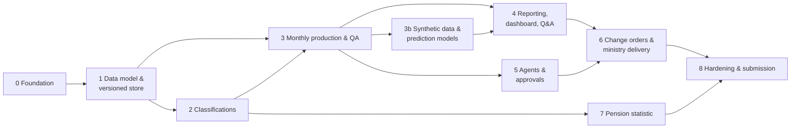

# Phases – Building StatAgent as a Web Application

This is the plan for turning the starter package into a local, offline web application covering every role, rule and deliverable of Use Case 3.

- **Problem IDs** (`DQ-`, `PEN-`, `KL-`, `ENV-`, `SPEC-`, `RD-`) refer to [Problems.md](Problems.md).
- **Rule IDs** (`T1–T8`, `Z1–Z8`), tech stack and architecture are in [StateOfDevelopment.md](StateOfDevelopment.md) §6–§7.
- Priority: **[MIN]** = needed for the minimum / the Fri 09:00 submission · **[OPT]** = needed for the optimum score.
- **Ground rule:** no package file or delivered data is edited, renamed or deleted.
  - Faulty records stay in every statistic and graph.
  - Handling is done only by reading rules at read time.
  - Graphs mark the affected part and offer an "as delivered" view.

---

## 1 Overview

Each phase ships its own **UI slice**, so the web app grows from Phase 0 on.

| Phase | Goal | Prio | Problems |
| --- | --- | --- | --- |
| 0 | DB running, app skeleton, repo safe to publish | MIN | ENV-01–05, 08–10, 12–15, SPEC-05 |
| 1 | Anhang-B model, raw load, versioned store, reading rules | MIN | ENV-06, ENV-07, DQ-01, DQ-03, DQ-09–11 |
| 2 | classifications with versions, transitions, source mappings | MIN/OPT | KL-01–08, DQ-07, DQ-08, DQ-15 |
| 3 | deterministic monthly runs, QA, 24 QBs | MIN | DQ-02, 04–06, 12–14, 16, 17, RD-01–03, 06, SPEC-01 |
| 3b | synthetic data generator, expected corridor (forecast) + error detector trained on it | OPT | DQ-02, 04, 16, RD-01–03, 06 |
| 4 | Aggregations-Sheet, interactive dashboard with source evidence, data Q&A | MIN/OPT | ENV-11 |
| 5 | coordinator + role agents, approval gate, git protocol | MIN | ENV-09, ENV-10, SPEC-07 |
| 6 | change orders 1–3, ministry delivery, live change | MIN | SPEC-02–04, DQ-05/06 (ministry), DQ-09–11 (day counts) |
| 7 | pension statistic | OPT | PEN-01–09, RD-04, RD-05 |
| 8 | reproducibility, integrity, docs, submission | MIN | ENV-08, ENV-14, SPEC-05 |

### 1.1 Progress (status 2026-11-06)

| Phase | Status | Done | Open |
| --- | --- | --- | --- |
| 0 | **mostly done** | PostgreSQL 16.15 · DB `statistik` · `.venv` + pinned `requirements.txt` · `.env`/`.env.example` · `.gitignore` · logging · CLI · path handling without renaming · project in the team repo `Merrixx/Attentionseeker3-case3` with README, `.gitattributes`, protocol export (`protokoll`) · first commit pushed by the team | web skeleton (styling reference below) |
| 1 | **done** | loader + integrity check (115 files, 10,152,292 rows) · Anhang-B model (`sql/020`) · operations schema `ops` (`sql/030`) · versioned store `store.segment` with problem flags (`sql/040`, `statagent/etl/store.py`) · 4 reading rules as proposals (`sql/050`) · approval with name + protocol · preview of proposed rules (rolled back) · profile = Problems.md §2.1 · CLI `migrieren`, `bestand`, `profil`, `regeln`, `freigeben`, `ablehnen` | R-DQ01 approved (Mercy, 2026-11-05 14:59) and applied; R-DQ03/09/10 await approval · web UI slice (after Phase 0 web skeleton) |
| 2 | **done** | `klass_geschlecht/qualifikation/alter/region/oenace` from the package files (`sql/060`, `statagent/etl/classification.py`, CLI `klassifikation`) · ÖNACE 2003/2008/2025 to the Unterklasse (5,027 codes, explanations from the COT files) · regions 2011–2026 as 2,965 historised states · 3,303 transitions (Umsteiger, derived sections with share, ODS change lists + same-code state changes, derived Bezirke) · Quellzuordnung with R-DQ07/R-DQ08 (approved by Mercy, 2026-11-05 15:45) · code check over all deliveries: all values "ok" · `erklaeren` (deterministic text) · reproducible checksum · unit tests | PDF cross-check · web UI slice (classification browser) |
| R | **done** | English clean-up of source and backend (team decision 2026-11-05): Python modules/identifiers/comments/logs, schemas `betrieb` → `ops`, `bestand` → `store`, raw helper tables (`roh.file`, `text_line`, `cell`, …), enum values and rule-parameter keys; `sql/005` renames existing databases in place (data, approvals and change log kept); Anhang-B model and delivered tables unchanged; CLI commands, help and output German · verified: store run checksum 2024-08 `cfade2d7…` identical to the pre-refactor runs, classification checksum `c37199e6…` unchanged, 06/2025 = 394,252, `pruefen` OK, tests pass | – |
| 0 (web) | **done** | Next.js 16 + React 19 + Tailwind v4 + shadcn/ui in `web/` (medlyn `globals.css` + `components/ui` copied unchanged, fonts self-hosted, no CDN), FastAPI JSON + SSE (`statagent/api/`, 127.0.0.1 only), pages Übersicht · Lieferungen · Läufe · Qualitätsberichte · Klassifikationen · Pensionen · Dashboard · Modelle · Fragen · Agent · Freigaben · Protokoll · Exporte; StatCard, Quellennachweis (wie geliefert / wie gelesen), ProgressCard, SqlBlock, cmdk, sonner · `pnpm build` passes, pages verified in headless Edge | – |
| 3 | **done** | `lauf` / `gesamtlauf` (`statagent/qa/run.py`): Z1–Z8 as SQL over `store.segment` + `quellzuordnung_wirksam` + `klass_alter`; gates (every VVH active on the Stichtag counted once, stat total = records, reconciliation, „nicht zuordenbar“ bucket); `store.month_record` (evidence per VVH), `store.month_flow`; published months frozen (`veroeffentlichen --von`); checksum per run · checks + findings for DQ-01…17, RD-01/02/03 (`qa/checks.py`), revision need with causes (`ops.revision`), Rückfragen RF-DQ02/04/16 · QB generator (`qa/report.py`) · **24 runs + 24 QBs** (`abgabe/qualitaetsberichte/basis/`), all totals = Problems.md §2.1 · calibration `kalibrierung`: **2,880/2,880 cells** of the example report with R-DQ05 (preview) · rerun of 08/2024 = same checksum `6e3d2952…` · proposed rules R-DQ02 (carry-forward 2025-10), R-DQ04 (FD 2025-03), R-DQ05 (age from year) | done: R-DQ03/05/09 approved, basis published (see row „3 (final)“) |
| 3b | **done** | seeded generator (`ml/synth.py`, calibrated on the real runs, region-specific seasonality, year-to-year rate variability, planted DQ-01/02/03/04 labels, checksum per seed) · detector (standardized logistic regression per problem) + corridor (seasonal median + conformal 99 % band) (`ml/models.py`) · `ops.model`, `synth.*`, model card page · metrics per population in MODELLE.md | – |
| 4 | **done (sheet MIN, chat + dashboard OPT)** | `aggregationen` fills `vorlagen/aggregationen_vorlage.xlsx` (formulas kept, extra rows only for codes without a template row, refuses if any sheet-month ≠ `stat_beschaeftigte`; 96 sheet-months checked) + sheet „Nachweis“ + Open-Data-File · statistics tool layer with SQL/definition/evidence envelope (`reporting/tools.py`) · chat (`agents/chat.py`): parser, Rückfrage from `ops.term`, StatCards, abstention, claim check (`reporting/claims.py`), answer log `ops.answer`, read-only DB connection · example questions answered (M/W 07/2026, time series, Fluktuation → Rückfrage, ÖNACE J, Gemeinde 62388) | `aggregationen --regelwerk auftraege` after the orders |
| 5 | **done** | coordinator + 4 roles (`agents/coordinator.py`), provider-neutral model adapter with per-call log (`agents/llm.py`, offline mode without key), proposals with diff + before/after (rules R-A1/2/3, code C-NNNN), code generation from a reviewed template with SHA-256 pinning and refusal without approval (`agents/codegen.py`), execution log, `--probe` dry runs · all four flows tested as dry runs | done: agent with Anthropic (no Azure access, ENV-10), orders given and approved |
| 6 | **done 06.11.** (carried out by the agent, task 14) | order 1 `category_level` (own version „Beschaeftigungskategorie“ in `klass_qualifikation`, n:1 transitions, sheet rows Arbeiter/Angestellte/Beamte) · order 2 `whole_month` (rule set `auftraege`, zeitraum_art „Monat“, last segment, age at month end) · order 3 `ministry_delivery` (latest delivery per day ≤ reporting month, range_agg days once per person, DQ-02 fallback for L2025-10, GEBURTSJAHR rule) → preview 07/2026: 32,741 persons, sorted, no duplicates, 11 s · real run 06.11.: same 32,741 persons | – |
| 7 | **done** | `pensionen`: header-based parsers for all 28 files (6 families, PVA/SVS format changes), `klass_versicherungstraeger` (areas ≠ Qualifikation, mergers 2020 as n:1 transitions), `klass_pensionsart`, source mappings for 7 spellings of sex, `stat_pensionen` + computed totals (PV, PV-UNS, PV-SELB, carriers, GES/VAP), VAN Tab 13 „nicht gemeldet“, 378 sum checks pass, jumps listed (RD-04 law effects) | – |
| 6 (rehearsal) | **verified** | full order path rehearsed in one rolled-back transaction: R-A1/R-A2/R-A3 approved by a test name (never committed) → classification level → 24 runs `auftraege` → sheet with rows Arbeiter/Angestellte/Beamte → ministry CSV; found and fixed: first run of a new rule set had no table statistics (quadratic plan) → `ANALYZE` after each month's records + hash anti-joins for the flows | – |
| 4 (dynamic DQ) | **done** | team decision: only R-DQ03, R-DQ05 (reworked: month 13 = wrong format, day/month swap, `fallback`, optional `exclude` with excluded records accounted in `store.month_excluded`) and R-DQ09 to be approved; all other problems handled per statistic: `statagent/reporting/quality.py` detects the problems touching the requested months/fields, three options each (`ops.dq_option`, official option = approval state of the rule) + free text (keyword mapping or model choosing an option ID, else note in `ops.dq_choice`), applied on a copy of only the affected records (`work.dq_copy`), result shown next to the official value · term catalogue `ops.term` with trigger/resolve patterns and conditions: Fluktuation, Personen, Arbeiter/Angestellte, Jahr, Entwicklung, Alter, ÖNACE break, Stichtag/Monat · tests added | 👤 approvals R-DQ03/05/09 |
| 3 (final) | **done – published** | R-DQ03/05/09 approved by Mercy (05.11. 23:19–23:20); store rebuilt, 24 runs 148–171 + QBs, calibration (totals + Tab1–12 match, 359 age cells differ by design of R-DQ05), all 24 months published 06.11. 00:22, sheet + Open-Data-File regenerated; 09/2024 = 393,453 (−1 by R-DQ09) – docs/RECOMPUTE.md | change orders (RUNBOOK §3) |
| 8 (polish) | **done 06.11.** | Problems.md §8: SW-05 feasibility check („nicht verfügbar“ + available alternatives), SW-06 three readings per term, SW-21 test entries deleted, SW-22 copies expire after 7 days, SW-29 links between pages restored (URL state `?monat`/`?lauf`/`?ansicht`/`?q`, evidence panel, Protokoll, QB) · 32 tests pass (1 skipped: R-DQ05 already decided) | 👤 SW-01 change orders, SW-02 push, SW-03 Azure keys |
| 4 (agent) | **done 06.11. – live** (Anthropic `claude-sonnet-5-5`, no Azure access) | data agent in „Fragen“: model picks one of 7 tools by function calling (employment, pensions, explain code, quality report, definition, not in data, decline out of scope) – numbers only from SQL; deterministic scope gate (history/physics/small talk declined), pension tool `tools.query_pension`, „Verwendete Dateien“ (files + SHA-256 + tables, `reporting/sources.py`), chart wish applied where the data fit, English questions, `/fragen?frage=` deep link, provider-neutral adapter (`AGENT_*` in `.env`), tests `tests/test_agent.py` | – (model switchable via `.env`) |
| 8 (polish 2) | **done 06.11.** | SW-07 recount on the copy for Personen and Zu-/Abgänge · SW-10 calibration „bestanden – erklärt“ (example-report reading 2,880/2,880) · SW-19 `sichern`/`wiederherstellen` (0.51 GB dump) · SW-27 marker `integration` + frontend smoke test · SW-28 chart fade-in, approval dialog, pin refresh | – |
| 8 (feedback) | **done 06.11.** | web feedback SW-30: Modelle scorecard, Basis/Aufträge labels, ministry gate, QB list 0.24 s, sensible chart kinds + curated prompts, stricter approver names, resumable change-order execution | – |
| 8 (Pensionen + jury) | **done 06.11.** | SW-31: Pensionen styling (hover names, instant marker note, small multiples, KPI total, transition graph direction), clickable run chips, Agent templates + `execute` intent, ministry export logged; RUNBOOK §7 jury script rewritten | – |
| 8 | **done** | tests 45 passing (pytest 8.4.2, ENV-16 resolved) · secret scan `geheimnisse`: 0 findings in history and tree · README, RUNBOOK (jury script), MODELLE.md, THIRD_PARTY_LICENSES.md | 👤 final commit + push to the submission repo |

### 1.2 Styling reference for all UI work

The UI copies the styling of the friend's repo <https://github.com/Julian-AT/medlyn> (`apps/app`) exactly. We have permission for this challenge.

| Aspect | medlyn | Consequence for StatAgent |
| --- | --- | --- |
| Framework | Next.js 16 (App Router), React 19, TypeScript | the frontend becomes a Next.js app (`web/`); FastAPI stays as the JSON API for data, runs and agents |
| Styling | Tailwind CSS v4, shadcn/ui (style `radix-luma`, base colour `neutral`, CSS variables), `tw-animate-css` | copy `app/globals.css` (tokens: gray scale + alpha, text-primary/secondary/tertiary, surface/raised, elevation shadows, radii, chart-1…5, sidebar, light/dark) and `components/ui/*` unchanged |
| Layout | `SidebarProvider` + `AppSidebar` + `SidebarInset` + `PageHeader` | same shell; our nav: Lieferungen · Läufe · Qualitätsberichte · Klassifikationen · Dashboard · Fragen · Agent · Freigaben · Protokoll |
| Fonts / icons | Inter (`next/font/google`) + Geist Mono; Hugeicons | **self-host Inter** (Google download breaks offline, ENV-14); Geist Mono comes from the `geist` package |
| Theme | light/dark via `.dark` class, stored in `localStorage` | same mechanism |
| Charts | Recharts 3 | **Recharts** (interactive: hover, zoom, brush, corridor bands) with `--chart-1…5`; data as JSON from FastAPI, numbers only from SQL. seaborn only for static images in exported reports |
| Dynamic elements | `motion`, AI SDK streaming + `streamdown`, `sonner` toasts, `cmdk` palette, `@xyflow/react`, `shiki`, `@tanstack/react-table`, `react-resizable-panels` | same libraries: animated cards and counters, streamed agent answers, live run progress („Lieferung 2025-03 wird gelesen … 100 %“), toasts for approvals, command palette, transition graphs for `klass_uebergang`, highlighted SQL, sortable tables, evidence side panel |
| Source evidence | chips under each chart (document · date) → „Source evidence“ panel with cited passage, context and DE/EN toggle | **„Quellennachweis“** under every number/chart: chips (Lieferung · Lauf · Regeln) → panel with SQL, delivery file + SHA-256, run + checksum, rules + approver, example records; toggle „wie geliefert / wie gelesen“; header „n Prüfungen · m Zahlen geprüft“ from the claim check |
| Language | English UI | **German UI** (all labels, help texts, reports); code and backend English (AGENTS.md product principles) |
| Tooling | pnpm, Biome, Node ≥ 20.9 | installed Node is **v19.7.0** (too old for Next.js 16) → install Node 22 LTS + pnpm |
| Licence | **CC BY-NC 4.0** (non-commercial) | fine for the challenge with the author's permission; **commercial use needs a separate licence from the author**. shadcn/ui, Tailwind, Next.js themselves are MIT |

---

## 2 Phases

### Phase 0 – Foundation [MIN]

1. Native PostgreSQL 16; DB/user/password `statistik`; run `01_schema.sql` unchanged (ENV-02). The compose file is not needed (ENV-01 resolved).
2. venv + pinned `requirements.txt` (fastapi, uvicorn, jinja2, psycopg[binary], pandas, openpyxl, odfpy, pypdf, seaborn, matplotlib, typer, openai, pytest; prefer releases older than 7 days) (ENV-13).
3. Git: clone the team repo (ENV-09).
   - `.gitignore`: `.DS_Store`, `.env`, logs, exports, and **`SV md files/Use Case 3 StatAgent.pdf/.md`** (password, ENV-08)
   - pre-commit secret scan
4. Config from `.env`: DSN, Azure endpoint/model, named users for approvals (ENV-10, T7).
5. Logging to `logs/`, `python -u` (ENV-12). Our README notes: the 27.10. task version is authoritative; the package README's references are outdated (ENV-05); Fri 09:00 is binding (SPEC-05).
6. Path handling without renaming: find `Änderungen` by pattern, skip `.DS_Store` (ENV-03, ENV-04).
7. Web skeleton in medlyn styling (§1.2: Next.js + shadcn/ui frontend, FastAPI JSON API; all assets local, ENV-14; German UI):
   - navigation: Lieferungen · Läufe · Qualitätsberichte · Klassifikationen · Dashboard · Fragen · Agent · Freigaben · Protokoll
   - login = choose a named user
   - shared components from the start: `Quellennachweis` panel (evidence for any number), animated progress card, chart wrapper with evidence chips
8. Typer CLI skeleton.

- UI: the Lieferungen page (load protocol).
- Acceptance: the app starts offline; no secret is in the git history.

### Phase 1 – Data model, raw load, versioned store (Datenmanagement) [MIN]

1. **Loader** (`statagent laden`) replaces `02_laden.sql` (ENV-15, ENV-07). It reads every package file unchanged:
   - deliveries → `roh.lieferung` / `roh.ladeprotokoll`
   - basic CSVs → `klassifikation.*`
   - ÖNACE TXT (cp1252), region CSVs, ODS sheets, pension cells (with file/sheet/cell) → raw tables (ENV-06)
   - row count + checksum per file; `ANALYZE`; indexes (ENV-12)
2. Anhang-B tables:
   - `stat_beschaeftigte`, `statistik_beschreibung`, `variable`, `klass_*`, `klass_uebergang`, `quellzuordnung`
   - operational: `lauf`, `regel` (type, parameters, SQL, start month, justification, approval), `annahme`, `auffaelligkeit`, `rueckfrage`, `freigabe`, `protokoll`
3. Versioned store `store.segment`: one row per (VVH_ID, BEGINN, delivery) with typed values, the raw values and problem flags. Raw values stay visible.
4. Reading rules as data:
   - DQ-01: read the 2025-06 columns swapped
   - DQ-03: count each VVH once
   - DQ-09/11: the later segment takes precedence
   - DQ-10: gap decision (flag + documented choice)
5. Profiling = the matrix of Problems.md §2.1, generated automatically.

- UI: the profile and rule hits per delivery; rule list with status.
- Acceptance (verified 2026-11-05):
  - [x] 24 deliveries = **10,152,292** rows, checksums match the files (`pruefen` OK)
  - [x] no row dropped: `store.segment` = 10,152,292 rows; duplicates kept with `copy_no > 1`
  - [x] with the rules (preview): 06/2025 = 394,252 active; the "as delivered" view still shows 21
  - [x] with R-DQ03 (preview): 2025-03 overlaps 164 → 1, "open + next" 1,500 → 0 (duplicate pairs no longer look like segments)
  - [x] the profile reproduces the Problems.md matrix (e.g. 08/2024: 392,236 active, 370 month-13, 7 age > 110, 50 ÖNACE 2003, 1,996 empty, 207 DQ-16 suspicions)
  - [x] reproducible: two builds of 2024-08 give the same checksum (`cfade2d7…`)
  - [x] full build of all deliveries (6 parallel workers): ~4 min
- Rule effect found by the preview: R-DQ09 lowers 09/2024 by 1 VVH (VVH 56000, DQ-11: the open segment ends before the one-day segment of 2024-08-31). Decide when approving.

### Phase 2 – Classifications (Klassifikation) [MIN core, OPT depth]

1. [MIN] `klass_geschlecht`, `klass_qualifikation` (+ category + FD flag), `klass_alter` (bis 14, 15 … 74, 75 u. mehr, unbekannt), each with "unbekannt" (DQ-15).
2. [MIN] One `klass_region` from both Bundesland files (KL-01). `klass_oenace` with versions 2003/2008/2025 and version-specific labels (KL-05).
3. [MIN] Quellzuordnung: empty BL → 0, empty ÖNACE → UNB (DQ-08); `DA…DM` → C (DQ-07).
4. [OPT] ÖNACE to the 5-Steller + Umsteiger 2003→2008→2025 with relation types (KL-02).
5. [OPT] Regions 2011–2026 with validity; Übergänge from snapshot diffs + ODS, PDFs as a cross-check (KL-03, KL-04).
6. "Explain transition": deterministic text from `klass_uebergang`; the agent only rephrases it.

- UI: classification browser (levels, versions, validity), transition explainer, source mappings.
- Acceptance: every delivered code resolves to exactly one `klass_` code; no concept exists twice.
- Result (verified 2026-11-05, `python -m statagent klassifikation`):
  - [x] tasks 1–6 built; region states use the in-force dates of the change lists between snapshots; PDFs not used yet
  - [x] one `klass_` table per concept (region, oenace, geschlecht, qualifikation, alter); Bundesland from both files in `klass_region` (KL-01)
  - [x] code check over all 24 deliveries: all 40,609,168 attribute values (4 per row) resolve to exactly one valid code; 40,505,417 directly from the classification files, 1,183 (ÖNACE 2003 codes) via R-DQ07 and 102,568 (empty values) via R-DQ08, both approved by Mercy (build 14)
  - [x] every Gemeinde/Bezirk code that disappears or appears 2011–2026 has a transition; findings KL-06–08
  - [x] reproducible: two builds give the same checksum (`c37199e6…`)
  - examples: `erklaeren oenace J --version 2008` (2008 → 2025: J 58 %, K 36 %, N 6 %), `erklaeren region 324` (Wien-Umgebung 2017 split 1:n into 4 Bezirke), `erklaeren region 62388`, `erklaeren oenace "C 10.71"`

### Phase 3 – Monthly production and QA (Datenmanagement + QS) [MIN]

1. Run engine:
   - `lauf --lieferung JJJJ-MM`: Z1–Z8 as parameterised SQL, own and earlier deliveries only, published months frozen
   - `gesamtlauf` = 24 single runs; checksum per run (T1)
2. **Calibration test:** 08/2024 = example report cell by cell (392,236; M 211,603 / F 180,633; 141,713 / 236,961 / 13,562; BL unbekannt 1,996; C 62,204; Alter unbekannt 7).
3. Reading rules and assumption views (affected records always stay in):
   - DQ-02: jump check → carry-forward view from L2025-09 → revision in QB 2025-11 → Rückfrage
   - DQ-04: category-share check → carry-forward view from L2025-02 → revision in QB 2025-04 → Rückfrage
   - DQ-16: counted as delivered; own-delivery detection → flagged in the QB; confirmed as revision in the next QB → Rückfrage
   - DQ-05: age from the year · DQ-06: age unbekannt · DQ-14, DQ-17: QB findings, not corrected
   - DQ-12/13: revision need vs the current delivery, artefacts separated, ÖNACE compared via the Übergänge
4. Real developments do not trigger corrections (RD-01/02/03/06): seasonal reference bands (I, F, A, Tirol/Salzburg), trend checks, *erklärt – plausibel*.
5. QB generator from the template (reconciliation, anomalies, Rückfragen, rules, revision); wording per rule set (SPEC-01). Rückfrage generator; answers become binding rules.

- UI: Läufe (start, live log, checksum), Qualitätsberichte, Annahmen with drill-down to example VVH_IDs.
- Acceptance: 24 runs + 24 QBs; the calibration test passes; re-runs are identical.

### Phase 3b – Synthetic data and prediction models [OPT]

Like medlyn's verifier trained on 100k synthetic patients: we generate our own data and train on it, keep the populations apart and report metrics honestly. Models never calculate official numbers (T1) and never correct data; they flag and propose, a person approves (T7).

1. **Synthetic delivery generator** (`statagent/ml/synth.py`, schema `synth`): simulate VVH lifecycles (starts, ends, attribute changes, seasonality per section and Bundesland, Beamte trend) calibrated on the 24 real deliveries; write N years of monthly deliveries in the delivered format; plant **labelled** errors with random type, month and intensity (all DQ types: swapped columns, missing share, exact duplicates, missing FD, phantom double registrations, month 13, age > 110, ÖNACE-2003 codes, empty fields, overlaps, gaps, late reports). Seeded and reproducible (seed → same checksum).
2. **Expected corridor** (forecast): per series (total; Bundesland; section; category; sex) predict the next month from own and earlier months only; prediction interval from the synthetic residuals. Outside the corridor → suspected data error (QB: *erklärt – Datenproblem* or *nicht erklärbar*), inside → *erklärt – plausibel* (RD-01 seasonality, RD-02 trend). Must not alarm on real developments and must flag 10/2025 (DQ-02) and FD 03/2025 (DQ-04).
3. **Error detector**: features per delivery and per record (empty BEGINN share, ENDE < BEGINN, duplicate share, FD share, jump vs. corridor, new-VVH patterns of the same person, segment structure, …) → classifier trained on the synthetic deliveries; evaluation on held-out synthetic data (macro-F1) and on the 24 real deliveries with Problems.md §2.1 as labels. Output: finding with probability and the features that drove it, plus a proposed rule – never an automatic correction.
4. **Determinism and provenance**: fixed seeds; `ops.model` with model file hash, training data hash, metrics and date; predictions stored in `synth`/`ops` tables with model version, labelled „Modell“, never in `stat_*`. New dependencies (scikit-learn) only as releases older than 7 days.

- UI: corridor bands in the charts, detector findings with probability and features, model card page (data, metrics, limits, like medlyn's model card).
- Acceptance: generator reproducible; detector finds DQ-01/02/03/04 in the real deliveries; corridor covers the seasonality of I/F/A and Tirol without false alarms; metrics reported with separate populations.

### Phase 4 – Reporting, dashboard, Q&A [MIN sheet, OPT rest]

1. [MIN] Aggregations-Sheet into `aggregationen_vorlage.xlsx` (openpyxl, keep the formulas): equal totals across sheets; "Open-Data-File" = `stat_beschaeftigte`, documented (ENV-11).
2. [OPT] interactive dashboard (Recharts + motion, §1.2):
   - charts: time series, M/W, Bundesland, ÖNACE, categories, **fluctuation per sector**, age pyramid; corridor bands from Phase 3b
   - every chart carries its **Quellennachweis**: SQL + definition + data table, delivery file + checksum, run, rules + approver, example records
   - affected parts marked (month-13 share, 2003-coded share, unbekannt bars)
   - toggle „wie geliefert“ / „mit Leseregeln“ (06/2025, 10/2025, 03/2025)
   - footnote for the ÖNACE break; transition graph (xyflow) for `klass_uebergang`
3. [OPT] Data Q&A:
   - the agent writes SQL for a **read-only** role and the SQL + definition are always shown
   - the answer text is rendered from the query result; a **claim check** verifies every number in the text against the result before display, missing data is „nicht vorhanden“, contradictions (published vs. current delivery) are shown side by side
   - ambiguous questions (Stichtag vs month, VVH vs person, ÖNACE version) get a clarifying question
   - metadata questions are answered from `klass_*`, `variable`, `statistik_beschreibung` (and the deterministic `erklaeren` text)

- UI: Dashboard, Fragen, export buttons.
- Acceptance: sheet totals = `stat_` totals; example questions (time series, M/W 07/2026, fluctuation per sector) are answered with visible SQL.

### Phase 5 – Agents and approvals (Koordination) [MIN]

1. Azure adapter (model from `.env`, exchangeable, model/version logged per call) (T4, ENV-10).
2. Coordinator = one entry point → routes to the 4 role agents. Text instructions; voice optional (SPEC-07).
3. Deterministic tools: read-only SQL, propose a rule, propose a code file (`statagent/generated/`), start a run, export.
4. Approval gate: diff → named approval with timestamp; generated code is approved before its first run; every execution is logged (T6, T7).
5. Git protocol: one commit per approval, instruction + `Freigegeben-von: Name` (T8, ENV-09). Before/after view of the numbers.

- UI: Agent console, Freigaben inbox, Protokoll.
- Acceptance: a sample instruction goes through proposal → approval → commit → re-run → before/after; nothing becomes active without approval.

### Phase 6 – Change orders and ministry delivery [MIN]

First freeze the old-rule series (ÄA: "zuerst nach den bisherigen Regeln").

1. Order 1 via the agents: categories Arbeiter/Angestellte/Beamte, retroactive; new sheet rows (SPEC-04). `klass_qualifikation` already carries the category as an attribute; a category level needs codes that do not clash with the Qualifikation code `Beamte` (PK version + code).
2. Order 2 via the agents: whole-month rule, last segment, age at month end; separate rule-set version → both series (SPEC-02). DQ-09–11 rules apply.
3. Re-run 24 months → new QBs + second Aggregations-Sheet.
4. Order 3: `ministerium_2026-07.csv` from the versioned store, using the latest delivery per day (SPEC-03):
   - ArbeiterDV/FD in section C of the delivery's classification
   - days de-duplicated, ≥ 200
   - sorted by PERSON_ID
   - GEBURTSJAHR decision for DQ-05; `Unbekannt` for DQ-06
5. Live-change rehearsal (e.g. 5-year age groups, Wien separately, exclude Beamte).

- UI: rule-set switch (old/new), ministry export with parameters and preview.
- Acceptance: three approved agent commits; both sheets; a reproducible ministry CSV.

### Phase 7 – Pension statistic [OPT]

1. Header-based parsers: PVA old/new (women first from 2022), SVA/SVB + legend, VAEB/BVAEB text numbers, VAN (Tab 12 only = "nicht gemeldet"), SVS old/new (PEN-01–04).
2. `klass_versicherungstraeger` (carrier → area, mergers 2020 with n:1 transitions, PV branch; PVA Arbeiter/Angestellte **not** Qualifikation) (PEN-05–07). `klass_pensionsart`; sex via Quellzuordnung (PEN-08, PEN-09).
3. `stat_pensionen` + description + variables; computed totals over all carriers.
4. Checks: sum of parts; year-over-year jumps explained (RD-04, RD-05, Notariat break).

- UI: pension dashboard pages, carrier classification with merger explanation.
- Acceptance: all 28 files load; totals add up.

### Phase 8 – Hardening and submission [MIN]

1. Reproducibility (two full runs identical, T1). **Integrity:** package files and `roh.*` checksums unchanged since the first load.
2. Offline test; LLM features degrade gracefully (ENV-14). Secret scan of the whole git history (ENV-08).
3. README sections per the Teilnahmeinformationen; `THIRD_PARTY_LICENSES` (incl. psycopg LGPL, seaborn BSD) + CC BY 4.0 credit.
4. Deliverables:
   - both Aggregations-Sheets
   - 24 QBs per series
   - `ministerium_2026-07.csv`
   - protocol export
   - `MODELLE.md`
5. Jury script: solution → errors found → one assumption in detail (DQ-02 or DQ-16) → live change → data questions.

- Acceptance: a fresh clone + README reproduces all deliverables by Fri 09:00 (SPEC-05).

---

## 3 Coverage

| Problem | Phase | Problem | Phase | Problem | Phase |
| --- | --- | --- | --- | --- | --- |
| DQ-01, 03 | 1 | ENV-01–05 | 0 | PEN-01–09 | 7 |
| DQ-02, 04 | 3 | ENV-06, 07 | 1 | KL-01–08 | 2 |
| DQ-05, 06 | 3, 6 | ENV-08 | 0, 8 | SPEC-01 | 3 |
| DQ-07, 08 | 2 | ENV-09, 10 | 0, 5 | SPEC-02–04 | 6 |
| DQ-09–11 | 1, 6 | ENV-11 | 4 | SPEC-05 | 0, 8 |
| DQ-12–14 | 3 | ENV-12 | 0, 1 | SPEC-07 | 5 |
| DQ-15 | 2 | ENV-13 | 0 | RD-01–03, 06 | 3 |
| DQ-16, 17 | 3 | ENV-14 | 0, 8 | RD-04, 05 | 7 |
| | | ENV-15 | 0, 1 | | |
| | | ENV-16 | 8 | | |

| Scoring area | Minimum in | Optimum in |
| --- | --- | --- |
| 1 Datenmanagement | Phase 1 | Phase 1 + 7 |
| 2 Klassifikation | Phase 2 tasks 1–3 | Phase 2 tasks 4–6 |
| 3 Qualitätssicherung | Phase 3 | Phase 3 (all DQ, RD separation) + Phase 3b (corridor, detector) |
| 4 Reporting | Phase 4 task 1 | Phase 4 tasks 2–3 (dashboard with Quellennachweis, Q&A with claim check) |
| 5 Weiterentwicklung und Betrieb | Phase 3 | Phases 5 + 6 |
| 6 Bedienbarkeit | CLI from Phase 0 | web UI slices of all phases |
