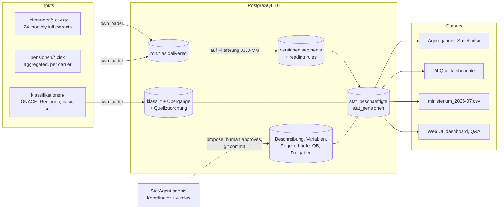

# State of Development – StatAgent (KI Challenge 2026, Use Case 3)

Status as of 2026-11-06 (update in §5). This is one of three project documents:

| Document | Content |
| --- | --- |
| **StateOfDevelopment.md** (this file) | current state, how everything fits together, environment and tech stack, rules and scoring |
| [Problems.md](Problems.md) | every current issue in data, package, environment and specification |
| [Phases.md](Phases.md) | the plan for building the web application |
| [docs/references.md](docs/references.md) | prior art: papers, standards (GSBPM, VTL, SDMX, NACE) and open-source software, with relevance and licence |

Original documents. They are **unchanged and authoritative**, and this file links to them instead of repeating them. The task documents are in the folder `SV md files/`:

| File | Content |
| --- | --- |
| `SV md files/Use Case 3 StatAgent.md` (+ `.pdf`, 27.10.2026) | the task: process, five steps, technical rules, Anhang A–C, scoring |
| `SV md files/KI Challenge Teilnahmeinformationen.md` (+ `.pdf`) | event schedule, GitHub submission, data protection, general jury criteria |
| `SV md files/Fachbeschreibung.md` | record layout, classifications, **counting rules**, output formats |
| `SV md files/aenderungsauftraege.md` | the three change orders in full |
| `SV md files/StatAgent Aufgabenstellung für die Teams.md` | older version of the task (23.10.), superseded by `Use Case 3 StatAgent.md` |
| `SV md files/README.md` | the package README (moved here in the repo because the root `README.md` describes our solution): package overview, DB start, performance hints |
| `vorlagen/qualitaetsbericht_vorlage.md`, `vorlagen/rueckfrage_vorlage.md` | templates for the quality report and queries |

---

## 1 Summary

- The repo holds the challenge's **starter package** (input data, specifications, templates, an example report, a PostgreSQL bootstrap) plus our code for Phases 0–1 (see "Built so far").
- The goal is a **StatAgent**: an agent-supported but deterministically calculating production system. It produces:
  - the employment statistic `stat_beschaeftigte`, from 24 monthly deliveries of individual records (10,152,292 rows)
  - a pension statistic, from aggregated carrier reports in 7 format variants
  - the metadata for both (classifications, variables, descriptions)
- The deliveries contain **planted errors** and **real developments** → [Problems.md](Problems.md).
- **No delivered data or package file is edited.** Errors stay in the files and in `roh.*`. They are handled only by documented reading rules applied at read time, and faulty records stay in every statistic and graph.
- This machine: Windows 10 IoT Enterprise, 16 GB RAM, 12 threads, 238 GB free.
  - PostgreSQL 16.15 runs as a Windows service on port 5432.
  - Python 3.10 with `.venv` (pinned `requirements.txt`).
- **Built so far (Phases 0–2):**
  - `statagent/` package with the CLI `python -m statagent migrieren | laden | pruefen | bestand | profil | klassifikation | erklaeren | regeln | freigeben | ablehnen | protokoll`
  - the loader `statagent/etl/load.py`, the store builder `statagent/etl/store.py`, the classification builder `statagent/etl/classification.py`, the explainer `statagent/reporting/explain.py`, approvals `statagent/core/rules.py`, the change-log export `statagent/core/change_log.py` and German enum labels `statagent/core/labels.py`
  - SQL: `005` in-place rename of older databases to the English names · `010` raw sources · `020` Anhang-B model (German, as prescribed) · `030` operations (`ops`) · `040` versioned store (`store`) · `050` seed data + 4 reading rules (R-DQ01/03/09/10) · `060` classifications (views `klass_alle`, `quellzuordnung_wirksam`, mapping rules R-DQ07/08)
  - English clean-up done 2026-11-05 (team decision): code, logs and own schemas English, CLI/UI German; checked against the anchors (store 2024-08 run checksum `cfade2d7…`, classification checksum `c37199e6…`, 06/2025 = 394,252)
  - `tests/` unit tests for the pure classification helpers
  - `.env.example`, `.gitignore`
  - **the project lives in the team repo `Merrixx/Attentionseeker3-case3`** (SSH; local working copy `AttentionSeekers3`):
    - `README.md` per Teilnahmeinformationen
    - `.gitattributes` keeps the package files byte-identical (no CRLF conversion)
    - `abgabe/protokoll/protokoll.md` holds the approvals
    - commits and pushes are made by the team
    - `..\SV usecase3` stays as the original download
  - **database loaded and verified (2026-11-05):**
    - all 115 package files registered with SHA-256
    - 24 deliveries = 10,152,292 rows; `pruefen` OK
    - cross-check: 08/2024 Stichtag = 392,236 = example report
    - DB size 1.2 GB; full load takes ~1.5 min; unchanged files are skipped on re-runs
  - **versioned store built (2026-11-05):**
    - `store.segment` = 10,152,292 rows with problem flags; ~4 min full build
    - profile = Problems.md §2.1
    - R-DQ01 approved (Mercy, 2026-11-05 14:59) and applied: 06/2025 = 394,252 active (21 as delivered); R-DQ03/09/10 are still proposed
  - **classifications built (2026-11-05):**
    - 8,115 `klass_` entries (ÖNACE 2003/2008/2025 to the Unterklasse, regions 2011–2026 as historised states, Geschlecht, Qualifikation, Alter), 3,303 transitions, 91 source mappings; ~1 s, reproducible checksum
    - code check over all 24 deliveries: all 40,609,168 attribute values resolve to exactly one valid code; 103,751 of them via the mapping rules R-DQ07/R-DQ08 (approved by Mercy, 2026-11-05 15:45)

---

## 2 Folder structure

```
AttentionSeekers3/                    local working copy of the team repo Merrixx/Attentionseeker3-case3
├── SV md files/                      task docs: Use Case 3 StatAgent.pdf/.md (local only, ENV-08), KI Challenge Teilnahmeinformationen.pdf/.md,
│                                     Fachbeschreibung.md, aenderungsauftraege.md, StatAgent Aufgabenstellung für die Teams.md (older)
├── README.md                         our solution README (package README: SV md files/README.md)
├── AGENTS.md                         ground rules and commands for coding agents
├── abgabe/protokoll/protokoll.md            exported change protocol (T8)
├── .gitattributes                    package files byte-identical in git
├── StateOfDevelopment.md, Problems.md, Phases.md   project docs (ours)
├── statagent/                        our code (English): cli.py (German commands), config.py, migration.py, core/ (rules.py, change_log.py, labels.py),
│                                     etl/ (load.py, store.py, classification.py), reporting/ (explain.py)
├── sql/005 … 060_*.sql               our schema next to the delivered one: rename of old DBs, raw sources, Anhang-B model, ops, store, seed data + rules, classifications
├── tests/                            unit tests (pytest)
├── logs/                             run logs (untracked)
├── requirements.in / requirements.txt, .env.example, .gitignore, .venv/ (local)
├── beispielbericht_2024-08.xlsx      reference report 08/2024 (Deckblatt, Inhalt, Erläuterungen, Tab1–Tab13)
├── docker-compose.yml                PostgreSQL 16 container (renamed by the team from docker-compose(1).yml)
├── datenbank/01_schema.sql, 02_laden.sql   schemas roh + klassifikation; loader for the container
├── lieferungen/                      24 × lieferung_JJJJ-MM.csv.gz (2024-08 … 2026-07; ';', UTF-8)
├── klassifikationen/
│   ├── bundesland, geschlecht, qualifikation, oenace_2008, oenace_2025 .csv   basic set (UTF-8)
│   ├── oenace/                       ÖNACE 2003/2008/2025, all levels (CTI, CKT, COT, CAL) + Umsteiger (cp1252)
│   └── regionen/                     gemeinden_/bezirke_JJJJ-01-01.csv (2011–2026), bundeslaender.csv, LIESMICH.txt,
│                                     A╠ênderungen/ (= Änderungen; ODS + 4 PDFs)
├── pensionen/2018 … 2025/            28 Excel files, one per carrier and year, + LIESMICH.txt
└── vorlagen/                         aggregationen_vorlage.xlsx, ministerium_vorlage.csv, qualitaetsbericht_vorlage.md, rueckfrage_vorlage.md
```

---

## 3 How everything works together

### 3.1 Process and data flow

Every statistic goes through the same steps: **Anlieferung → Prüfen und bereinigen → Anreichern → Aggregieren und speichern → Ergebnisse prüfen → Bereitstellen**.



### 3.2 Roles and the five steps (all roles must be covered)

| Step | Role | Uses | Result |
| --- | --- | --- | --- |
| 1 Read and check data | Datenmanagement | 24 deliveries, local DB | data model per Anhang B, versioned store |
| 2 Build metadata | Klassifikation | checked data, classification files | `klass_*` historised, one per concept, with transitions |
| 3 Monthly operation | Datenmanagement + Qualitätssicherung | one delivery per run | result + quality report per month |
| 4 Provide results | Reporting | database | Aggregations-Sheet, answers to data questions with visible SQL |
| 5 Develop further | all, via a **Koordination** entry point | change orders, pension reports | 3 changes, ministry delivery, pension statistic |

### 3.3 Existing infrastructure

- `docker-compose.yml`: `postgres:16`, DB/user/password `statistik`, port 5432. It mounts `datenbank/` as init scripts and `lieferungen/` + `klassifikationen/` read-only (not `pensionen/`).
- `01_schema.sql`: `roh.lieferung` (lieferung + 9 text columns), `roh.lieferung_import`, `roh.ladeprotokoll`, and `klassifikation.{oenace_2008, oenace_2025, bundesland, geschlecht, qualifikation}` (code + label only).
- `02_laden.sql`: loads the 5 basic CSVs and all deliveries, creates indexes on `lieferung` and `vvh_id`, runs `ANALYZE`.
  - It works only inside the Linux container (paths `/daten/…`, `COPY FROM PROGRAM 'gunzip'`).
  - It does not load `oenace/`, `regionen/` or `pensionen/`.

### 3.4 Target data model (Anhang B, mandatory)

| Object | Content |
| --- | --- |
| `stat_<statistik>` | long format, one value per row: `zeitraum_art, zeitraum_von, zeitraum_bis, <one code column per dimension>, variable, wert, status (vorläufig/endgültig/gesperrt), stand` |
| Beschreibung (per statistic) | name, source, type (Einzeldaten / aggregiert), dimensions → classification + level, notes, footnotes |
| Variablentabelle (shared) | statistic, variable code (= `stat_.variable`), label, description (definition, unit, calculation) |
| `klass_<begriff>` (shared, **one per concept**) | code, label, level, parent code, valid from–to, version |
| Übergänge | old code → new code, relation 1:1 / 1:n / n:1 / m:n, validity date |
| Quellzuordnung | how a source writes a value ("W", "2", "Frauen") → code; replaces a second classification |

A new statistic gets its own `stat_` table and description, adds its variables to the shared table and reuses the existing `klass_` tables. Example rows from the task:

```
Stichtag;2025-03-31;2025-03-31;6;C;W;ArbeiterDV;45;Beschaeftigungsverhaeltnisse;3;endgueltig;Lieferung 2025-03
Jahresdurchschnitt;2025-01-01;2025-12-31;PVA-ARB;ALTER;M;Pensionen;395763;endgueltig;Meldung PVA 2025
```

---

## 4 Verified data facts

### 4.1 Deliveries

- Fields `VVH_ID; PERSON_ID; GEBURTSDATUM; GESCHLECHT; BEGINN; ENDE; QUAL; OENACE; BUNDESLAND`; the header is identical in all 24 files.
- Each delivery is a full extract of the reporting month plus the 2 previous months. A VVH (Versicherungsverhältnis) consists of consecutive time segments. Codes are ÖNACE 2008 up to 12/2024 and ÖNACE 2025 from 01/2025.
- Stable across deliveries: PERSON_ID, GEBURTSDATUM and GESCHLECHT per VVH. None of these occur: BEGINN after the reporting date, records outside the 3-month window, persons under 15.
- Row counts, Stichtag counts and problem counts per delivery: [Problems.md §2.1](Problems.md).

### 4.2 Calibration against `beispielbericht_2024-08.xlsx`

| Item | Example report | What it implies (verified against the raw data) |
| --- | --- | --- |
| Total 08/2024 | 392,236 (M 211,603 / F 180,633) | Stichtag rule, one count per VVH; includes the DQ-16 phantoms |
| Arbeiter / Angestellte / Beamte | 141,713 / 236,961 / 13,562 | freie Dienstverträge included in Arbeiter/Angestellte |
| Bundesland unbekannt | 1,996 | empty BUNDESLAND → code 0 |
| In Wirtschaftszweigen eingereiht | 390,240 | empty OENACE → UNB |
| ÖNACE C | 62,204 | 62,154 `C` + 50 ÖNACE-2003 codes `DA…DM` |
| Age "unbekannt" | 7 | only ages > 110 |
| Birth month 13 | not "unbekannt" | 370 cases counted with age = 2024 − birth year (exact match per age) |
| Age bands | bis 14, 15 … 74, 75 u. mehr | "75 u. mehr" = 0 |

### 4.3 Classification and pension sources

- **Basic set:** Bundesland 0–9 (0 = unbekannt), Geschlecht M/W, Qualifikation (5 codes + BESCHAEFTIGUNGSKATEGORIE + FD flag), ÖNACE 2008 A–U + UNB, ÖNACE 2025 A–V + UNB.
- **`oenace/`:** levels 1–5 (5-Steller `A 01.11-0` / EDV `A01110`), 4 output forms, Umsteiger 2003→2008 (1,305 pairs, Unterklasse → Unterklasse) and 2008→2025 (1,115 pairs).
  - codes per level: 2003 17 / 31 / 62 / 224 / 514 / 722 (with Unterabschnitte, only the COT file) · 2008 21 / 88 / 272 / 615 / 701 · 2025 22 / 87 / 287 / 651 / 711
  - validity: ÖNACE 2003 2003–2007, 2008 from 1.1.2008, 2025 from 1.1.2025 (deliveries: 2008 up to 12/2024)
- **`regionen/`:**
  - 16 versions 2011–2026: Gemeinden 2,379 → 2,114, Bezirke 122 → 117
  - change lists: ODS with code changes, mergers, splits and Bezirk changes; PDFs 2002–2027 and since 1945
  - licence CC BY 4.0, Statistik Austria
- **`pensionen/`:**
  - Tabelle 12 (Pensionsstand) and 13 (vorzeitige Alterspensionen), 2018–2025
  - carriers 2018–2019: PVA, SVA, SVB, VAEB, VAN; 2020–2025: PVA, BVAEB, SVS
  - internal totals all consistent; totals across carriers must be computed
  - format details: PEN-01/02 in Problems.md

### 4.4 Templates (`vorlagen/`)

- **Aggregations-Sheet:** sheets Bundesland, Geschlecht, OENACE_2008 (2024-08…12), OENACE_2025 (2025-01…2026-07), Beschaeftigungskategorie. Rows are categories + an "Insgesamt" formula, columns are months. Empty cell = 0; do not rename rows.
- **Qualitätsbericht:** overview with the reconciliation *read = counted + not counted + excluded*, anomalies (*erklärt – plausibel / erklärt – Datenproblem / nicht erklärbar*), queries, applied rules, revision need.
- **Rückfrage:** delivery, number of records, 3–5 example VVH_IDs, SQL, proposal, question.
- **Ministerium:** `PERSON_ID;GESCHLECHT;GEBURTSJAHR;TAGE`.

---

## 5 Gap analysis (status 2026-11-06)

| Area | Exists | Missing |
| --- | --- | --- |
| Raw storage, versioned store, classifications, metadata | **done** (Phases 1–2) | approvals of R-DQ03/09/10 |
| Production | **done and published** (06.11.): 24 runs with R-DQ01/03/05/07/08/09, all months `endgueltig`; gates, checksums, evidence per record (docs/RECOMPUTE.md) | second series `auftraege` after the change orders |
| Quality assurance | **done**: checks DQ-01…17 + RD-01/02/03, revision need with causes, 24 QBs, Rückfragen RF-DQ02/04/16, calibration 2,880 cells („bestanden – Abweichungen vollständig durch R-DQ05 erklärt“) | answers of the Fachabteilung |
| Reporting | **done**: Aggregations-Sheet (basis), Open-Data-File, statistics tools, chat with claim check (employment + pensions, charts chosen per answer, used files listed), dynamic DQ handling on a copy (Verhältnisse, Personen and Zu-/Abgänge), dashboard | sheet `auftraege` after the orders |
| Agents | **done**: coordinator + 4 roles, proposals with diff/before-after, generated code with SHA-256 approval gate, offline mode · data agent in „Fragen“: the model (Anthropic `claude-sonnet-5-5`; no Azure access received, ENV-10; switchable any time via `AGENT_*` in `.env`) picks one of 7 tools by function calling – employment, pensions, explain code, quality report, definition, not in data, decline out of scope; numbers only from SQL + claim check; every answer lists its files (SHA-256) and tables | no Azure access (ENV-10, Anthropic used instead); the team's instructions |
| Change orders + ministry | **done 06.11.**: instructions given to the agents, R-A1/2/3 approved, carried out by the agent (24 runs `auftraege`, sheet, 24 QBs), ministry CSV 32,741 persons, released | optional: publish `auftraege` |
| Pensions | **done**: 28 files, 6 format families, carrier classification with 2020 mergers, `stat_pensionen` + totals, 378 sum checks | – |
| Models | **done**: synthetic generator, detector, corridor, model card | – |
| UI, repo, docs | **done**: web app (13 pages), README, RUNBOOK, abgabe/MODELLE.md, THIRD_PARTY_LICENSES, 45 tests + frontend smoke test, secret scan (incl. agent keys), page links via URL state, database dump/restore (`sichern`/`wiederherstellen`) | commits by the team |

## 6 Environment and tech stack

### 6.1 Database runtime: native PostgreSQL 16 for Windows

| Option | Verdict |
| --- | --- |
| **Native PostgreSQL 16** (installer: <https://www.enterprisedb.com/downloads/postgres-postgresql-downloads>, zip without admin: <https://www.enterprisedb.com/download-postgresql-binaries>) | **chosen**: runs directly, no VM, full speed for 10 M rows, PostgreSQL License |
| Podman / Docker Engine in WSL2 or a Linux VM | possible (Apache-2.0); only useful to run `02_laden.sql` exactly as shipped, and that still covers only part of the data |
| Docker Desktop | not chosen: free only for personal use, education, non-commercial OSS and companies with < 250 employees **and** < USD 10 M revenue; government entities and larger organisations need a paid subscription |

With native PostgreSQL, `01_schema.sql` runs unchanged. Our own **loader** reads every package file unchanged into raw tables (deliveries into the delivered `roh.*` tables) and logs row counts and checksums. That replaces `02_laden.sql` (ENV-15).

### 6.2 Stack

| Layer | Choice | Licence |
| --- | --- | --- |
| Language | Python ≥ 3.10 | PSF |
| Database / driver | PostgreSQL 16 / psycopg 3 (`psycopg[binary]`) | PostgreSQL License / LGPL-3.0 (OK as an unmodified dependency; permissive alternative pg8000) |
| SQL | plain versioned `.sql` files, parameterised queries, no ORM (readable rules, T3) | – |
| Data / files | pandas, numpy, openpyxl (xlsx), odfpy (ods), pypdf | BSD-3, MIT, Apache-2.0, BSD-3 |
| Web | **frontend:** Next.js 16 + React 19 + Tailwind v4 + shadcn/ui in the exact styling of <https://github.com/Julian-AT/medlyn> (Phases.md §1.2), German UI, fonts self-hosted → offline; dynamic elements as in medlyn's `apps/app`: `motion`, AI SDK streaming, `sonner`, `cmdk`, `@xyflow/react`, `shiki` · **backend:** FastAPI + Uvicorn as JSON API | MIT (frameworks); medlyn styling CC BY-NC 4.0, used with the author's permission (non-commercial) |
| Charts | **Recharts** in the UI (interactive, corridor bands, Quellennachweis per chart); seaborn + matplotlib only for static images in exported reports | MIT / BSD-3 |
| Models | scikit-learn (+ numpy, pandas) locally with fixed seeds for the expected corridor and the error detector, trained on our synthetic deliveries (Phases.md Phase 3b); to be added as a release older than 7 days | BSD-3 |
| CLI | Typer; German command names (`statagent lauf --lieferung 2025-03`), English code behind them | MIT |
| LLM | `openai` SDK (`AzureOpenAI`) behind our own adapter; model from `.env`, exchangeable (T4) | Apache-2.0 |
| Agents | own thin orchestrator: coordinator + 4 role agents with tool calling and an approval gate | – |
| Protocol / tests | git CLI (one commit per approved change) / pytest | GPL-2.0 (used as a tool only) / MIT |

**seaborn for commercial use: yes.** BSD-3, no fees, no copyleft; same for matplotlib, pandas and numpy. Keep the notices in `THIRD_PARTY_LICENSES`. It renders static images only, which is why the UI charts are Recharts (team decision 2026-11-05: dynamic UI like medlyn); seaborn stays for report exports. Use the object-oriented matplotlib API (pyplot is not thread-safe) and never `sns.load_dataset()` (it needs internet).

### 6.3 Target architecture

```
statagent/                  (English code; German CLI command names and UI texts)
├── api/        FastAPI JSON API (data, runs, rules, approvals, agents, evidence)
│   (outside the Python package: web/ – Next.js app in medlyn styling, German UI · sql/ – migrations, views, rule SQL · tests/)
├── core/       config (.env), DB connection, rules + approvals, change log (git protocol)
├── etl/        loader (raw), versioned store, classifications, pensions (7 parsers)
├── qa/         checks, findings, quality report + Rückfrage generators
├── ml/         synthetic delivery generator, expected corridor, error detector, model registry (Phase 3b)
├── reporting/  explanations, Aggregations-Sheet, ministry delivery, evidence (Quellennachweis), Q&A with claim check
├── agents/     LLM adapter, coordinator, role agents, tools, prompts
└── cli.py      German commands: lauf, gesamtlauf, laden, klassifikation, erklaeren, freigeben, protokoll, frage …
```

Database schemas: `public` = Anhang-B model with the prescribed German names (`stat_*`, `klass_*`, `variable`, `quellzuordnung`, …) · `roh` = delivered raw tables (unchanged) plus our English helper tables for the other package files · `klassifikation` = delivered basic set · `ops` = rules, approvals, change log, runs, findings, models · `store` = versioned store · `synth` = synthetic data (Phase 3b).

Principle: **agents propose → a named human approves → deterministic code/SQL runs → git records it.** No LLM in the calculation path.

---

## 7 Rules and criteria

### 7.1 Deadlines and deliverables

| When | What |
| --- | --- |
| Thu 5.11. 12:00 / 16:00 / 17:00 | start / SV-BOX registration deadline via e-mail / Q&A |
| **Fri 6.11. 09:00** | **submission** (SV BOX); the GitHub repo must be complete as well |
| Fri 6.11. 10:00–11:30 | Fachjury, ~15 min per team |
| Fri 6.11. 12:00–13:15 | final round (best team per use case), awards (5,000 / 3,000 / 2,000 €) |

Submission:
- [ ] Aggregations-Sheet (Bundesland, Geschlecht, ÖNACE, Beschäftigungskategorie) for all months, **old rules and after the change orders**
- [ ] 24 quality reports
- [ ] `ministerium_2026-07.csv`
- [ ] protocol of all agent changes
- [ ] model statement

Public GitHub repo:
- code, configuration (no secrets), documentation of the approach and key decisions, tests
- **README** with: solution/approach, how to run, dependencies, configuration, known limitations

### 7.2 Technical rules (task "Technische Regeln")

| # | Rule |
| --- | --- |
| T1 | Numbers enter the DB only through code that runs without a language model; same data + rules → same numbers |
| T2 | Program and DB run locally and offline; they start by hand via CLI or WebUI |
| T3 | Rules and mappings live in the DB as readable data, not hidden constants |
| T4 | Agents use the provided Azure models; the model must be exchangeable |
| T5 | Our own agents (not the dev tool) carry out operational changes and deliveries, on natural-language instructions |
| T6 | Agent-written code: readable documented file, startable via CLI/WebUI, runs without an LLM, **approved before the first run**, logged with instruction and result |
| T7 | A team member approves every rule/code change and every delivery: name + time + object (no "Team") |
| T8 | Protocol per change: instruction, change, approver. One git commit with the instruction as message + `Freigegeben-von: Name` is enough |

### 7.3 Business rules for faulty data (Anhang A)

1. **No relationship is lost.** A record that appears several times counts once.
2. Assumptions are justified and documented, including how each affected record was assigned. They appear in the QB.
3. Rückfragen to the Fachabteilung are optional and need evidence (delivery, number of records, example IDs). **The answer is binding** and becomes a rule.
4. Points for justified, documented, defensible assumptions. **Losing relationships or "correcting" a real development costs points.**

### 7.4 Counting rules and change orders (in full: `SV md files/Fachbeschreibung.md` §4, `SV md files/aenderungsauftraege.md`)

| Rule | Base rules (Z1–Z8) | After orders 1 + 2 (retroactive, together) |
| --- | --- | --- |
| Unit | VVH, not person (Z1) | unchanged; each VVH once per month |
| Counted if | a segment exists on the month's last day: BEGINN ≤ Stichtag and (ENDE empty or ≥ Stichtag) (Z2) | ≥ 1 day in the month: BEGINN ≤ month end and (ENDE empty or ≥ month start) |
| Attributes | from the segment valid on the Stichtag (Z3) | from the last segment in the month |
| Delivery | the month's own delivery; published months are never changed; differences = revision need (Z4) | unchanged |
| Age | completed years on the Stichtag (Z5) | on the month end |
| Category | ArbeiterDV, AngestellteDV, Beamte, ArbeiterFD, AngestellteFD (Z6) | Arbeiter, Angestellte, Beamte (order 1) |
| ÖNACE | 2008 up to 12/2024, 2025 from 01/2025 (Z7) | unchanged |
| Missing values | own justified assumptions, nothing lost, documented in the QB (Z8) | unchanged |

**Order 3 – ministry delivery:**
- **Who:** persons with **≥ 200 calendar days** as ArbeiterDV/ArbeiterFD in ÖNACE section C, within the 12 months up to and including the reporting month (07/2026 → 01.08.2025–31.07.2026). Simultaneous VVH count a day once; DV + FD days are added.
- **Data basis:** **for each day, the latest delivery containing that day.**
- **Format:** `PERSON_ID;GESCHLECHT;GEBURTSJAHR;TAGE` (unplausible birth dates: `Unbekannt`), sorted by PERSON_ID, `ministerium_JJJJ-MM.csv`.

**Monthly operation:**
- one run = one delivery (`lauf --lieferung 2025-03`), in chronological order 2024-08 … 2026-07
- a run uses only its own and earlier deliveries; an overall run = 24 single runs
- each run produces the month's values, its Aggregations-Sheet column and its QB
- every newly found error becomes a check or reading rule
- after each change order the months run again one by one

### 7.5 Scoring (Fachjury, 6 × 20 = 120 points)

| Area | Minimum | Optimum |
| --- | --- | --- |
| 1 Datenmanagement | all deliveries read correctly, data model per Anhang B | versioned store across deliveries; all pension formats read |
| 2 Klassifikation | needed classifications, one per concept | ÖNACE to the 5-Steller, regions fully historised, transitions from the official lists, explained on request |
| 3 Qualitätssicherung | finds some errors, QB per month | finds all errors, separates them from real developments, every assumption justified |
| 4 Reporting | Aggregations-Sheet per the Fachbeschreibung | correct answers to data questions (incl. classifications and metadata), dashboard |
| 5 Weiterentwicklung und Betrieb | production runs deterministically | all change orders + ministry delivery, traceably logged, live change by language works |
| 6 Bedienbarkeit | everything via console: start runs, view results and QBs, approve changes | clear web UI for runs, QBs and assumptions, classifications, approvals, data questions |

**Jury session (~15 min):**
1. Presentation: the solution, the errors found, **one assumption in detail**.
2. **Live change** by language through our agents, with protocol and before/after numbers.
3. Data questions, e.g. time series, men vs women, fluctuation per sector.

**General criteria (Teilnahmeinformationen §5):** methodology and data/AI quality · benefit and impact · feasibility and time-to-impact · transparency and responsible AI · usability and communication · innovation. A prototype is enough. The final round wants approach, functions, benefit, limits and next steps, ideally with a live demo.

### 7.6 Publication, data protection, organisation

- Only synthetic data. SV-BOX data is public.
- **Never publish passwords, API keys, tokens or confidential data.** The SV-BOX password is in `SV md files/Use Case 3 StatAgent.pdf/.md`, so exclude these files from the public repo. Azure keys go only in an untracked `.env`.
- Credit regional data with "Quelle: Statistik Austria" (CC BY 4.0).
- Teams of at most 5. Free choice of tools. Document the methods and key technical decisions.
- Performance and version hints (PostgreSQL ≥ 14, `ANALYZE`, `NOT EXISTS`, `python -u`, venv): `SV md files/README.md` (package README).

---

## 8 Guiding principles

1. **Calibrate on 08/2024 first.** Every cell of the example report must match (total 392,236).
2. **Never edit delivered data, never lose a VVH.** Faulty records stay in all statistics and graphs, and unknowns become explicit `Unbekannt` codes.
3. **Every handling is a reading rule stored as data:**
   - it is applied at read time
   - it carries an assumption, a justification, the affected records and a start month
   - it is approved by a named person and reported in the QB
   - graphs mark the affected part and offer an "as delivered" view
4. **Production is deterministic; agents only propose.** A human approves and git records it.
5. **One versioned store** (segment × delivery) serves the monthly runs, the revision need and the ministry delivery.
6. **No AI hallucinations.** An LLM never states a number or fact; it chooses tools, IDs and templates, text is rendered from query results, and a claim check verifies every shown number against its query. Missing = „nicht vorhanden“, never guessed; conflicting sources are shown side by side.
7. **Every number carries its evidence.** SQL, delivery file + SHA-256, run + checksum, rules + approver, classification version, example records „wie geliefert / wie gelesen“ – visible in the UI as „Quellennachweis“.
8. **Synthetic data and models stay apart from the statistic.** Own schema `synth`, seeded and versioned models, honest metrics on separate populations; predictions are labelled „Modell“, flag and propose only, never enter `stat_*` and never correct data.
9. **English code, German surface.** Code, logs and own schemas in English; the Anhang-B model, delivered tables, domain terms and everything users see in German.
