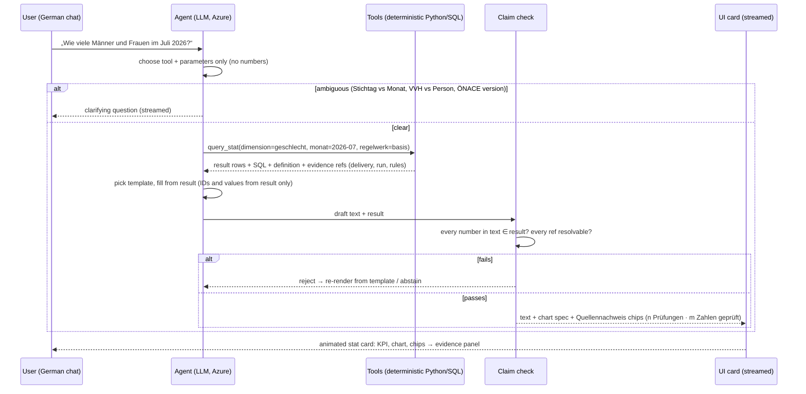
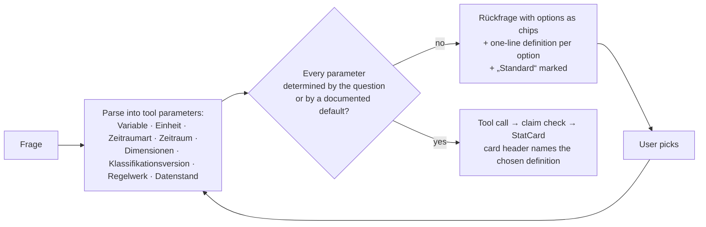

# PRD – StatAgent (KI Challenge 2026, Use Case 3)

> **Historical document.** This was the build plan of 05.11.2026 evening. Everything in it is implemented; the current state is in `StateOfDevelopment.md`, `Phases.md` §1.1 and `Problems.md` §8. The ✅/🔧/⚠️ markers below reflect 05.11.

Product requirements and game plan for the remaining build. Written for hand-over to an implementing agent ("Fable") and the team. Status 2026-11-05 evening; submission **Fri 6.11. 09:00**.

Read with: [AGENTS.md](../AGENTS.md) (ground rules, product principles, commands), [Phases.md](../Phases.md) (plan + progress), [StateOfDevelopment.md](../StateOfDevelopment.md) (state, stack, rules T1–T8, scoring), [Problems.md](../Problems.md) (data issues DQ/PEN/KL/ENV/SPEC/RD), [references.md](references.md) (prior art, licences). Task documents in `SV md files/`.

---

## 1 Vision

An agent-supported, **deterministically calculating** statistics production for the Dachverband der Sozialversicherungsträger. It turns 24 monthly deliveries of insurance relationships (10,152,292 rows) into the official employment statistic, maintains the metadata (classifications with versions and transitions), finds and documents data errors, answers data questions in a chat with charts – and **never lets an AI invent a number**. Every number shown carries its evidence (Quellennachweis), and every change is approved by a named person and recorded in git.

The product pattern follows **medlyn.health** (§1.1): the model reads and selects, the facts come from the record; if it isn't there, say so; contradictions are shown side by side; own models are trained on self-generated synthetic data and evaluated honestly; the UI is calm, animated and source-linked.

### 1.1 medlyn.health – the reference pattern (half of the idea)

[medlyn.health](https://medlyn.health) / [Julian-AT/medlyn](https://github.com/Julian-AT/medlyn) (AIM Healthcare Hackathon 2026, Track 1 Clinical Documentation; CC BY-NC 4.0, styling used with the author's permission) turns a clinician's role and task into **source-linked patient facts**: one screen with only the facts the task needs, every line linked to the sentence or table row it came from. Its three promises – *"100 % of facts link to their source"*, *"If it isn't documented, Medlyn says so"*, *"When two documents disagree, Medlyn points out the contradiction instead of silently picking one"* – are exactly what an official statistic needs from an AI assistant. StatAgent is medlyn for statistics: role and task → the numbers the task needs, each linked to delivery, run, rule and record. The UI should also be like it and also the generation of the statistics in the chat with dynamic ui.

| medlyn.health | What it does there | StatAgent equivalent |
| --- | --- | --- |
| Role + task → one screen of facts | „Anaesthetist, pre-op check“ → age, blood thinner, allergy, heart function; the rest stays out | Role (Datenmanagement, QS, Reporting, Jury) + question → one StatCard with exactly the numbers asked for (§6 F4) |
| Models select fact IDs, templates render | *"We let models select fact IDs, then render registered templates"*; one claim validator gates every statement across UI, chat, speech and letters | LLM chooses tool + parameters + template; numbers only from SQL; **claim check** gates every answer (§5.1) |
| Source evidence panel | chips under each fact/chart → „Source evidence“: cited passage, context, DE/EN toggle | **Quellennachweis**: chips (Lieferung · Lauf · Regeln) → SQL, file + SHA-256, run + checksum, rules + approver, example records; toggle „wie geliefert / wie gelesen“ (§7) |
| Proven absence | exhaustive lexical + full-document check before saying „not documented“; failed checks show „Couldn't check“ | „nicht geliefert / nicht vorhanden“ only after the deterministic query ran; „nicht prüfbar“ when the check itself failed – never a guessed number |
| Contradictions adjudicated, both sources shown | GP letter „allergic“ vs. admission note „none known“ side by side | published month vs. later delivery (Revisionsbedarf, DQ-12), „wie geliefert“ vs. „mit Leseregeln“ (DQ-01/02/04) shown as two values, never averaged |
| Own verifier trained on **100k synthetic patients** | generator from templates, corpus kept separate from ingested patients, QLoRA verifier, metrics reported per population (synthetic held-out vs. real text), model card | **synthetic deliveries** calibrated on the 24 real ones with planted labelled errors → **corridor + error detector**, evaluated on held-out synthetic **and** the real deliveries, model card with honest metrics (§5.2, F3b) |
| Engine guarantees | facts stored only with located source quotes; one evidence window per request; reviews appended, never overwriting | `roh.*` never changed; one run = one delivery + earlier ones; approvals and change log append-only; rules as data |
| Honest limits | „cold load 10.1 s misses the 10 s target“, „local verifier trails GPT“, removed unmeasured results | QB and model card state what was not found, not corrected, not measured; findings „nicht erklärbar“ are escalated, not hidden |
| UI | Next.js 16, shadcn/ui (radix-luma, neutral), Tailwind v4, Inter + Geist Mono, Hugeicons; `motion`, AI SDK streaming + `streamdown`, Recharts 3, `sonner`, `cmdk`, `@xyflow/react`, `shiki`; streamed „Medlyn reading the record … 100 %“ cards; landing page with GSAP/Lenis | same stack and tokens (`globals.css`, `components/ui` copied), German UI; ProgressCard „Lieferung 2025-03 wird gelesen … 100 %“, streamed StatCards in the chat, transition graph, highlighted SQL (§7) |

What we deliberately do **not** copy: medlyn's GPT-in-the-loop extraction (our numbers never pass through a model), its cloud database (we run local and offline, T2), and any commercial use of the styling (CC BY-NC).

## 2 Goals and non-goals

**Goals (scored, 6 × 20 points)**
1. Datenmanagement: all deliveries read correctly, Anhang-B data model, versioned store, pension reports of all carriers.
2. Klassifikation: one `klass_` table per concept, ÖNACE to the 5-Steller, regions 2011–2026 fully historised with transitions, explained on request.
3. Qualitätssicherung: find all planted errors, separate them from real developments, every assumption justified; one quality report per month.
4. Reporting: Aggregations-Sheet, correct answers to data questions (incl. metadata), dashboard.
5. Weiterentwicklung und Betrieb: deterministic production, three change orders + ministry delivery via our agents, live change by language, protocol.
6. Bedienbarkeit: everything via console; clear web UI for runs, QBs, assumptions, classifications, approvals and questions.

**Non-goals**
- No automatic correction of data. Models and agents flag and propose; a person approves (Anhang A, T7).
- No LLM in the calculation path (T1). No cloud for production or database (T2); only the agents call the provided Azure models.
- No editing, renaming or deleting of delivered files. Faulty records stay in every statistic and chart.
- No commercial use of the medlyn styling without a separate licence (CC BY-NC 4.0).

## 3 Users

| User | Needs |
| --- | --- |
| Statistikteam (Datenmanagement, Klassifikation, QS, Reporting, Koordination) | start runs, read QBs, approve rules and deliveries, explain transitions, answer data requests |
| Fachabteilung | understand assumptions and Rückfragen; answers become rules |
| Fachjury (15 min) | see the solution, the errors found, one assumption in detail; give a live change by language; ask data questions |
| Ministerium | receive `ministerium_2026-07.csv` |

## 4 Product principles (binding, see AGENTS.md)

1. **The program calculates, the AI does not** (T1). Same data + rules → same numbers; checksum per run.
2. **No AI hallucinations.** An LLM never states a number or fact itself. It chooses tools, IDs and templates; text is rendered from query results; a **claim check** verifies every number against its source query before display; missing data → „nicht vorhanden / nicht geliefert“; conflicting sources are shown side by side.
3. **Every number carries its evidence**: SQL, delivery file + SHA-256, run + checksum, rules + approver, classification version, example records „wie geliefert / wie gelesen“.
4. **Rules as data, approved by a named person** (T3, T7); one git commit per change with `Freigegeben-von:` (T8).
5. **Synthetic data and models stay apart** from the statistic: schema `synth`, seeded, versioned, labelled „Modell“, honest metrics on separate populations.
6. **English code, German surface.** Code, logs, `ops`/`store` schemas in English; Anhang-B model, delivered tables, CLI commands and UI in German.

---

## 5 Architecture (Aufbau)

```mermaid
flowchart TB
  subgraph Paket["Delivered package (read-only, SHA-256 registered)"]
    L[lieferungen/*.csv.gz<br/>24 monthly deliveries]
    K[klassifikationen/<br/>ÖNACE, Regionen, Grundausstattung]
    P[pensionen/*.xlsx<br/>28 carrier reports]
    V[vorlagen/, beispielbericht]
  end

  subgraph DB["PostgreSQL 16 (local, offline)"]
    direction TB
    ROH[(roh.* – as delivered<br/>+ raw helper tables)]
    PUB[(public – Anhang B, German<br/>stat_beschaeftigte, stat_pensionen<br/>klass_*, klass_uebergang, quellzuordnung<br/>variable, statistik_beschreibung)]
    STORE[(store.segment – versioned store<br/>segment × delivery, problem flags)]
    OPS[(ops – rule, approval, change_log<br/>run, finding, inquiry, model)]
    SYN[(synth – synthetic deliveries,<br/>labels, predictions)]
  end

  subgraph Py["statagent (Python, English code)"]
    ETL[etl: load · store · classification · pensions]
    RUN[qa: lauf --lieferung JJJJ-MM<br/>Z1–Z8 as SQL, checks, QB, Rückfragen]
    ML[ml: synth generator · corridor · error detector<br/>seeded, versioned, flags only]
    REP[reporting: explain · Aggregations-Sheet<br/>ministry CSV · evidence · charts data]
    AG[agents: coordinator + 4 roles<br/>tools, claim check, approval gate]
    API[api: FastAPI JSON + SSE streaming]
  end

  subgraph UI["web/ – Next.js, medlyn styling, German UI"]
    NAV[Lieferungen · Läufe · Qualitätsberichte · Klassifikationen<br/>Dashboard · Fragen (Chat) · Agent · Freigaben · Protokoll]
    EV[Quellennachweis panel]
    CH[Recharts + motion + streaming]
  end

  AZ[(Azure OpenAI<br/>exchangeable model)]
  GIT[(git: one commit per change<br/>Freigegeben-von: Name)]
  OUT[Deliverables: 2 × Aggregations-Sheet · 24 QBs<br/>ministerium_2026-07.csv · protokoll.md · MODELLE.md]

  L & K & P & V --> ETL --> ROH
  ROH --> ETL --> STORE & PUB
  STORE --> RUN --> PUB & OPS
  PUB & STORE --> ML --> SYN & OPS
  PUB & STORE & OPS & SYN --> REP --> OUT
  REP & RUN & OPS --> API --> UI
  AG <--> AZ
  AG --> API
  AG -. proposes .-> OPS
  UI -. named approval .-> OPS --> GIT
```

### 5.1 Anti-hallucination pipeline (chat and agents)



Rules of the pipeline:
- Tools are the only source of numbers. Each tool returns `rows`, `sql`, `definition`, `evidence` (delivery, run_id, checksum, rules + approver, klass version). Read-only DB role for agent SQL.
- The LLM output for a data answer is a **template choice + parameter bindings**, not free text with numbers. Free text is allowed only for explanation, and still passes the claim check (numbers/IDs must appear in the result).
- Abstention is a first-class answer: „nicht vorhanden“, „nicht geliefert“, „mehrdeutig – bitte präzisieren“.
- Contradictions (published month vs. current delivery = Revisionsbedarf) are returned as two values side by side, never averaged or chosen.
- Every answer is logged (question, tool calls, SQL, result hash, model id) for the protocol.

### 5.2 Synthetic data → models (Phase 3b)

```mermaid
flowchart LR
  R[24 real deliveries<br/>store.segment] --> CAL[Calibrate: start/end hazards,<br/>attribute shares, seasonality,<br/>Beamte trend, late reports]
  CAL --> GEN[Generator (seed)<br/>N synthetic years of monthly deliveries<br/>in delivered format]
  GEN --> ERR[Plant labelled errors<br/>DQ-01…17 with random month,<br/>type, intensity]
  ERR --> SYN[(synth.delivery, synth.label)]
  SYN --> TR1[Train corridor model<br/>per series, intervals via MAPIE]
  SYN --> TR2[Train error detector<br/>features per delivery/record]
  TR1 & TR2 --> EVAL[Evaluate: held-out synthetic<br/>+ real 24 deliveries (Problems.md labels)]
  EVAL --> MC[Model card + ops.model<br/>hashes, metrics, limits]
  TR1 --> USE1[Corridor bands in charts & QB:<br/>outside = suspected error,<br/>inside = erklärt – plausibel]
  TR2 --> USE2[Findings with probability + features<br/>→ proposed rule → human approves]
```

Guarantees: fixed seeds; generator output has a checksum; predictions never enter `stat_*`; synthetic and real populations are never mixed; metrics are reported per population (as medlyn reports synthetic vs. real-text F1).

### 5.3 Ambiguous questions → Rückfrage, never a guess

A statistic request is only executed when every parameter that changes the number is determined. If a term has more than one defensible reading, the agent **asks back** with the options as chips (medlyn's clarification requests, kept separate from the answer). The agent never picks silently and never answers two interpretations at once without saying so.



Ambiguity catalogue (maintained as data in `ops.term`, shown in the Rückfrage; extendable by the Fachabteilung):

| Term in the question | Possible readings | Default (only if the question gives no hint) |
| --- | --- | --- |
| **Fluktuation** | (a) Zugänge + Abgänge an Verhältnissen im Monat; (b) nur Abgänge; (c) Fluktuationsrate = Abgänge ÷ Bestand am Vormonatsende; (d) Wechsel von Personen zwischen Dienstgebern/Wirtschaftszweigen | none – always ask |
| Beschäftigte / Beschäftigung | Versicherungsverhältnisse (Zählregel Z1) vs. Personen | Verhältnisse (Z1), stated in the card |
| im Monat / im Juli | Stichtag Monatsletzter (basis) vs. ganzes Monat (Auftrag 2) | basis, unless the rule set is „Aufträge“ |
| Wirtschaftszweig J, G … | ÖNACE 2008 (bis 12/2024) vs. ÖNACE 2025 (ab 01/2025); comparison across the break | version of the asked month; across the break → ask or show both with Übergang |
| Bundesland | Arbeitsort (as delivered) – Wohnort is not available | Arbeitsort, stated |
| Arbeiter / Angestellte | with or without freie Dienstverträge (DV+FD vs. DV only) | with FD (example report), stated |
| aktuell / jetzt / zuletzt | latest reporting month (2026-07) vs. latest delivery containing a day (ministry logic) | latest published month, stated |
| Veränderung / Entwicklung | absolute vs. relative; vs. Vormonat vs. Vorjahresmonat | ask if two numbers are plausible, else absolute + relative both shown |
| wie geliefert / bereinigt | as delivered vs. with approved reading rules (R-DQ01/07/08 …) | with approved rules; „wie geliefert“ available as toggle |
| Alter | am Stichtag (Z5) vs. Geburtsjahrgang; single years vs. Gruppen | Z5, single years; groups on request |
| Revision | published value vs. value from the current delivery | both, side by side (never one) |

Rules: a default is only used when it is documented in the table and is always printed in the card header („Definition: Verhältnisse am Stichtag 31.07.2026, ÖNACE 2025, mit Leseregeln“). The chosen reading is stored in the answer log. If the user's follow-up changes the reading, the card is re-rendered with an animated transition and the new definition.

### 5.4 Beispielfragen – suggestions, never enforced

The chat shows a field **„Beispielfragen“** with 6–8 suggestion chips (role-aware, rotating), e.g.: „Zeitreihe der Beschäftigten 08/2024–07/2026“ · „Männer und Frauen im Juli 2026“ · „Fluktuation je Wirtschaftszweig 2025“ · „Was ist aus ÖNACE-Abschnitt J geworden?“ · „Welche Annahmen gelten für Lieferung 2025-10?“ · „Beamte nach Bundesland, Entwicklung“ · „Erkläre Gemeinde 62388“ · „Zeig mir den Qualitätsbericht 2025-03“. A click fills the input (editable), it does **not** submit. Sources: a curated list in `ops.prompt_suggestion` + the user's recent questions; the jury's example questions are included. Free text always wins; suggestions are hints for discoverability (the ambiguous „Fluktuation“ chip is on purpose: it demonstrates the Rückfrage).

---

## 6 Functional requirements by phase

Status: Phases 0 (mostly), 1, 2 and the English refactor are done; see Phases.md §1.1. Below: what remains, with acceptance criteria. Priority **[MIN]** = needed for the submission, **[OPT]** = optimum score.

### F0 Web skeleton [MIN] (open part of Phase 0)
- Next.js 16 + Tailwind v4 + shadcn/ui, `globals.css` tokens and `components/ui` copied from medlyn `apps/app`; Inter self-hosted; German UI; FastAPI JSON API + SSE.
- Navigation: Lieferungen · Läufe · Qualitätsberichte · Klassifikationen · Dashboard · Fragen · Agent · Freigaben · Protokoll. Login = choose a named user (used for approvals).
- Shared components from day one: `Quellennachweis` panel, `ProgressCard` (animated, streamed), `StatCard` (KPI + Recharts + chips), `SqlBlock` (shiki), toasts (sonner), command palette (cmdk).
- Acceptance: app starts offline; Lieferungen page shows `roh.file` registry and `pruefen` result with evidence chips.

### F3 Monthly production and QA [MIN] (Phase 3)
- `lauf --lieferung JJJJ-MM`: Z1–Z8 as parameterised SQL over `store.segment` + `quellzuordnung_wirksam` + `klass_alter`; own and earlier deliveries only; published months frozen; `gesamtlauf` = 24 single runs; checksum per run.
- **No record is ever dropped:** values without an effective mapping go to a visible „nicht zuordenbar“ bucket or the run stops; reconciliation *gelesen = gezählt + nicht gezählt + ausgeschlossen* must add up or the run fails.
- Calibration test 08/2024 against the example report, cell by cell (392,236; M 211,603 / F 180,633; 141,713 / 236,961 / 13,562; BL unbekannt 1,996; C 62,204; Alter unbekannt 7).
- Reading rules and assumption views for DQ-02, DQ-04, DQ-16 (carry-forward from earlier deliveries only, revision in the next QB, Rückfrage), DQ-05 (age from year), DQ-06 (age unbekannt), DQ-12/13 (revision need, artefacts separated, ÖNACE via Übergänge). Real developments RD-01/02/03/06 must not trigger corrections.
- QB generator from `vorlagen/qualitaetsbericht_vorlage.md` (German), one per month; Rückfrage generator from `rueckfrage_vorlage.md`; findings in `ops.finding`, inquiries in `ops.inquiry`.
- UI: Läufe (start, live progress card, checksum), Qualitätsberichte, Annahmen with drill-down to example VVH_IDs and their raw rows.
- Acceptance: 24 runs + 24 QBs; calibration test passes; two full runs give identical checksums.

### F3b Synthetic data and prediction models [OPT] (Phase 3b, §5.2)
- Generator, corridor, detector, model card as in §5.2; new dependencies (scikit-learn, MAPIE, sktime) only as releases older than 7 days.
- Acceptance: generator reproducible (seed → checksum); detector finds DQ-01/02/03/04 in the real deliveries; corridor covers the seasonality of I/F/A and Tirol without false alarms and flags 10/2025 and FD 03/2025; metrics reported with separate populations; model card page in the UI.

### F4 Reporting, dashboard, chat with statistics [MIN sheet, OPT rest] (Phase 4)
- [MIN] Aggregations-Sheet into `aggregationen_vorlage.xlsx` (formulas kept; equal totals across sheets; „Open-Data-File“ = `stat_beschaeftigte`).
- [OPT] Dashboard: time series, M/W, Bundesland, ÖNACE, categories, fluctuation per sector, age pyramid; corridor bands; marked affected shares (month 13, 2003 codes, unbekannt); toggle „wie geliefert / mit Leseregeln“; ÖNACE break footnote; transition graph (xyflow) for `klass_uebergang`. Every chart has its Quellennachweis.
- [OPT] **Fragen (chat that creates statistics)** – the medlyn-style core experience (§1.1: role + task → facts with evidence):
  - streamed answer (AI SDK / SSE) with inline **StatCards**: KPI numbers, Recharts chart, data table, SQL + definition, chips (Lieferung · Lauf · Regeln) → Quellennachweis panel; header „n Prüfungen · m Zahlen geprüft“.
  - the user can turn a card into a pinned dashboard tile or export it (CSV/PNG); follow-up questions refine the card (filter, dimension, period) with animated transitions.
  - Rückfrage with option chips for ambiguous terms (§5.3, e.g. „Fluktuation“); defaults printed in the card header; abstention when data is missing; revision contradictions shown as two values.
  - „Beispielfragen“ suggestion chips above the input (§5.4): fill, never submit.
  - metadata questions answered from `klass_*`, `variable`, `statistik_beschreibung` and the deterministic `erklaeren` text (agent only rephrases).
- Acceptance: sheet totals = `stat_` totals; the example questions (time series, M/W 07/2026, fluctuation per sector, „was ist aus ÖNACE J geworden?“) are answered with visible SQL and pass the claim check.

### F5 Agents and approvals [MIN] (Phase 5)
- Azure adapter (model from `.env`, exchangeable, model/version logged per call). Coordinator → 4 role agents (Datenmanagement, Klassifikation, QS, Reporting). Text instructions; voice optional.
- Deterministic tools: read-only SQL, propose rule, propose code file (`statagent/generated/`, readable, documented, CLI-startable), start run, export.
- Approval gate: diff → named approval with timestamp; generated code approved before its first run; every execution logged (T6, T7). Git protocol: one commit per approval with instruction + `Freigegeben-von: Name`; before/after numbers.
- UI: Agent console (streamed), Freigaben inbox, Protokoll.
- Acceptance: a sample instruction goes proposal → approval → commit → re-run → before/after; nothing becomes active without approval.

### F6 Change orders and ministry delivery [MIN] (Phase 6)
- Freeze the base-rule series first. Order 1 (categories Arbeiter/Angestellte/Beamte; category codes must not clash with Qualifikation code `Beamte`), order 2 (whole month, last segment, age at month end; separate rule set → both series), re-run 24 months → second sheet + QBs. Order 3: `ministerium_2026-07.csv` from the store, latest delivery per day, ≥ 200 days, de-duplicated, sorted; GEBURTSJAHR decision for DQ-05, `Unbekannt` for DQ-06.
- Live-change rehearsal (5-year age groups, Wien separately, exclude Beamte).
- Acceptance: three approved agent commits; both sheets; reproducible ministry CSV.

### F7 Pension statistic [OPT] (Phase 7)
- Header-based parsers for the 7 format variants (PEN-01–04), `klass_versicherungstraeger` with 2020 mergers (n:1 transitions), `klass_pensionsart`, sex via Quellzuordnung; `stat_pensionen` + computed totals; checks and explained jumps (RD-04/05).

### F8 Hardening and submission [MIN] (Phase 8)
- Two full runs identical; package and `roh.*` checksums unchanged; offline test; secret scan of git history; `THIRD_PARTY_LICENSES`; `MODELLE.md`; README per Teilnahmeinformationen; jury script (solution → errors → one assumption (DQ-02 or DQ-16) → live change → data questions).

---

## 7 UI specification (German, medlyn styling)

| Element | Behaviour |
| --- | --- |
| Shell | `SidebarProvider` + `AppSidebar` + `SidebarInset` + `PageHeader`; light/dark; Inter + Geist Mono; Hugeicons |
| StatCard | title, KPI with animated counter (motion), Recharts chart (line/bar/area with corridor band), data table toggle, `SqlBlock`, chips „Lieferung 2026-07 · Lauf 42 · R-DQ01, R-DQ07, R-DQ08“ |
| Quellennachweis panel | opens from any chip or number: cited rows (as delivered), context (neighbouring segments of the VVH), delivery file + SHA-256, run + checksum, rules with approver and time, classification version; toggle „wie geliefert / wie gelesen“ (like medlyn's DE/EN) |
| ProgressCard | streamed steps „Lieferung 2025-03 wird gelesen … 425.151 Sätze · Regeln angewendet · Prüfungen 12/12 · 100 %“ |
| Chat (Fragen) | streamed markdown (streamdown) with inline StatCards; **Rückfrage** as option chips with one-line definitions and a marked default (§5.3); abstention states; pin/export; follow-up refinement animates the card; card header always names the definition used |
| Beispielfragen | suggestion chips above the input (6–8, role-aware, rotating, from `ops.prompt_suggestion` + recent questions); click fills the input, never submits (§5.4) |
| Freigaben | inbox of proposals with diff and before/after numbers; approve/reject with the logged-in named user; toast + protocol entry |
| Klassifikationen | browser (levels, versions, validity), transition graph (xyflow), `erklaeren` text |
| Model card | data, seeds, hashes, metrics per population, limits, „Modell – keine amtliche Zahl“ banner |

---

## 8 Data contracts (new in Phases 3–5)

- `stat_beschaeftigte` (exists): `regelwerk, zeitraum_art, zeitraum_von, zeitraum_bis, region, oenace, geschlecht, qualifikation, alter, variable, wert, status, stand, lauf_id`.
- `ops.model`: `model_id, kind (corridor|detector), version, trained_at, data_hash, model_hash, metrics jsonb, seed, note`.
- `synth.delivery` (same columns as `roh.lieferung` + `synth_run, scenario`), `synth.label` (`synth_run, delivery, vvh_id/row, problem_id, intensity`), `synth.prediction` (`model_id, delivery, series, expected, lower, upper, actual, flag`).
- Tool result envelope for agents: `{rows, columns, sql, definition, evidence: {deliveries, run_id, checksum, rules: [{id, approved_by, at}], klass_versions}, warnings}`.
- Answer log: `ops.answer` (`asked_at, user, question, interpretation jsonb, tool_calls jsonb, result_hash, claim_check jsonb, model, text`).
- Ambiguity catalogue: `ops.term` (`term, reading_id, label_de, definition_de, sql_template, is_default, always_ask`); suggestions: `ops.prompt_suggestion` (`text_de, role, order, active`).

## 9 Acceptance summary (what the jury must be able to see)

1. Start a run from the UI, watch the progress card, open the QB, click a number → Quellennachweis.
2. Ask a question in German, get a streamed StatCard with chart, see „3 Zahlen geprüft“, open SQL and evidence.
2a. Click the suggestion „Fluktuation je Wirtschaftszweig“ → the agent asks back with the four readings → pick one → card with the definition in the header.
3. Give a live change by language → proposal → approve as a named person → commit → before/after numbers.
4. Show the corridor flagging 10/2025 and the detector naming DQ-01 in 2025-06, with the model card's honest metrics.
5. Show `pruefen` proving no delivered file changed.

## 10 Cross-check against the hackathon criteria

Status 2026-11-05 evening: ✅ fulfilled · 🔧 planned (phase) · ⚠️ risk / decision needed. Sources: `SV md files/KI Challenge Teilnahmeinformationen.md` §4–5, task (Technische Regeln, Abgabe, Bewertung, Anhang A/B).

### 10.1 Submission (Fri 09:00, SV BOX + public GitHub repo)

| Requirement | Status | Where |
| --- | --- | --- |
| Aggregations-Sheet (Bundesland, Geschlecht, ÖNACE, Beschäftigungskategorie), all months, old rules **and** after the change orders | 🔧 F4 / F6 | `reporting`, template `aggregationen_vorlage.xlsx` |
| 24 Qualitätsberichte (errors, assumptions with justification, assignments, revision need) | 🔧 F3 | QB generator, `ops.finding`, `ops.inquiry` |
| Ministeriums-Lieferung 07/2026 | 🔧 F6 | `ministerium_2026-07.csv` from `store.segment` |
| Protocol of all agent changes | ✅ mechanism (`ops.change_log`, `protokoll/protokoll.md`, 3 entries) · 🔧 git commit hash per entry (F5) | `change_log.py` |
| Short statement on the models used | 🔧 F8 | `MODELLE.md` (Azure model ids, our corridor/detector with model card) |
| Repo: code, config without secrets, documentation, tests | ✅ code/docs/tests · ⚠️ pytest 9.2.0 broken on Python 3.10 (ENV-16) · ✅ secrets only in `.env`, SV-BOX password files gitignored | README, AGENTS, Phases, Problems, `tests/` |
| README: solution + approach, how to run, dependencies, configuration, known limitations | ✅ | README.md |

### 10.2 Technische Regeln T1–T8 and Anhang A

| Rule | Status | Evidence |
| --- | --- | --- |
| T1 numbers only from code without an LLM; identical reruns | ✅ loader, store, classifications deterministic with checksums (`cfade2d7…`, `c37199e6…`) · 🔧 monthly runs (F3), claim check so chat numbers come only from SQL (F4) | `ops.run.checksum` |
| T2 local and offline, start via CLI/WebUI | ✅ PostgreSQL + Python local; CLI · 🔧 WebUI (F0); fonts self-hosted; only agents reach Azure | – |
| T3 rules and mappings as readable data | ✅ `ops.rule` (parameters, action), `quellzuordnung`, `klass_uebergang` | `sql/030`, `sql/060` |
| T4 provided Azure models, exchangeable | 🔧 F5 adapter, model from `.env`; ⚠️ no access to the Azure model received (ENV-10) – Anthropic used, switchable via `.env` | – |
| T5 own agents carry out operational changes, by language | 🔧 F5/F6 (coordinator + roles; change orders via agents) | – |
| T6 agent code: readable file, CLI-startable, no LLM at run time, approved before first run, logged | 🔧 F5 (`statagent/generated/`, approval gate, `ops.approval` type `code`) | – |
| T7 named human approves every rule/code/delivery | ✅ `freigeben --von "Name"`, DB rejects „Team“; 3 approvals by Mercy · 🔧 deliveries (F6) | `ops.approval` |
| T8 protocol per change, one commit with `Freigegeben-von:` | ✅ export + suggested message · ⚠️ team must commit per change (2 commits so far, R-DQ01/07/08 not yet committed separately) | `protokoll/protokoll.md` |
| Anhang A 1 – no relationship lost | ✅ store keeps all 10,152,292 rows; duplicates counted once by rule · 🔧 run gate „nicht zuordenbar“ + reconciliation (F3) | Problems.md §0 |
| Anhang A 2 – assumptions justified, documented, per record | ✅ rules carry Annahme/Begründung; `store.segment.rules` per row · 🔧 QB (F3) | – |
| Anhang A 3 – Rückfragen with evidence | 🔧 F3 generator from template; evidence (delivery, count, example IDs, SQL) available | `ops.inquiry` |

### 10.3 Scoring areas (6 × 20)

| Area | Minimum | Optimum | Status |
| --- | --- | --- | --- |
| 1 Datenmanagement | all deliveries read correctly, model per Anhang B | versioned store across deliveries; all pension formats | ✅ min (115 files, 10,152,292 rows, Anhang-B tables) · ✅ store · 🔧 pensions (F7, OPT) |
| 2 Klassifikation | needed classifications, one per concept | ÖNACE 5-Steller, regions fully historised, transitions from official lists, explained | ✅ min and most of opt (5,027 ÖNACE codes, 2,965 region states, 3,303 transitions, `erklaeren`) · 🔧 PDF cross-check, UI browser |
| 3 Qualitätssicherung | some errors found, QB per month | all errors, separated from real developments, every assumption justified | ✅ 17 DQ + 8 KL issues found and profiled · 🔧 24 QBs (F3) · 🔧 corridor/detector (F3b) |
| 4 Reporting | Aggregations-Sheet | data questions (incl. metadata) answered, dashboard | 🔧 F4 (sheet MIN; chat with StatCards, Rückfrage, Quellennachweis, dashboard OPT) |
| 5 Weiterentwicklung und Betrieb | deterministic production | all change orders + ministry delivery via agents, protocolled, live change works | ✅ determinism of built parts · 🔧 F3 runs, F5 agents, F6 orders |
| 6 Bedienbarkeit | everything via console | clear web UI (runs, QBs, assumptions, classifications, approvals, questions) | ✅ console (11 German commands) · 🔧 web UI (F0 + slices) |

### 10.4 General jury criteria (Teilnahmeinformationen §5)

| Criterion | How StatAgent answers it | Status |
| --- | --- | --- |
| Methodik, Daten- und KI-Qualität | GSBPM/ESS validation levels, rules as data, calibration against the example report, models evaluated on separate populations | ✅ method · 🔧 F3/F3b evidence |
| Nutzen und Wirkung | replaces manual monthly production; errors found with evidence; Rückfragen ready for the Fachabteilung; ministry delivery reproducible | 🔧 F3–F6 |
| Umsetzbarkeit, Time-to-Impact | runs on a laptop with PostgreSQL; standard stack; first results (store, classifications) already reproducible | ✅ |
| Transparenz, verantwortungsvoller KI-Einsatz | no AI numbers, claim check, Quellennachweis, named approvals, protocol, model card with honest metrics, abstention | ✅ principles · 🔧 F4/F5 implementation |
| Nutzbarkeit und Kommunikation | German UI in medlyn styling, chat that produces statistics, Beispielfragen, QBs in the official template | 🔧 F0/F4 |
| Innovationsgrad | medlyn pattern applied to official statistics; synthetic deliveries with planted errors to train a detector; corridor for RD vs. DQ separation | 🔧 F3b/F4 |

### 10.5 Data protection and publication (Teilnahmeinformationen §1, §3, §4)

| Requirement | Status |
| --- | --- |
| Only synthetic data; no real personal data | ✅ package data is synthetic |
| No API keys, passwords, tokens, internal documents in the public repo | ✅ `.env` untracked; `SV md files/Use Case 3 StatAgent.pdf/.md` (SV-BOX password) gitignored · 🔧 secret scan of history (F8) |
| Licences of external services/code respected | ✅ documented in references.md; medlyn CC BY-NC with permission; `THIRD_PARTY_LICENSES` 🔧 F8 |
| Regional data credited (CC BY 4.0, Statistik Austria) | ✅ README |

**Gaps that decide the score:** F3 (24 runs + QBs + calibration) and F6 (orders + ministry CSV) are the MIN items still open; F5 is needed for the live change. Everything else is OPT or polish.

## 11 Risks and mitigations

| Risk | Mitigation |
| --- | --- |
| Time (deadline Fri 09:00) | MIN first: F3 → F4 sheet → F5 → F6 → F8; F3b and dashboard extras only after MIN is green |
| Node v19 too old for Next.js 16 | install Node 22 LTS + pnpm before F0 |
| pytest 9.2.0 crashes on Python 3.10 (ENV-16) | pin older pytest (release > 7 days) or run test functions directly |
| Unmapped values dropping out of counts | left join + „nicht zuordenbar“ bucket + reconciliation gate (F3) |
| LLM answers numbers from memory | tool-only numbers, template rendering, claim check, read-only DB role, answer log |
| Agent silently picks one reading of an ambiguous term (e.g. Fluktuation) | ambiguity catalogue `ops.term`, Rückfrage with chips, defaults printed in the card header, interpretation stored in the answer log (§5.3) |
| Model flags real developments | corridor trained with seasonality; RD-01–03 as regression tests; models only propose |
| Azure keys/password leak | `.env` untracked, secret scan, `SV md files/Use Case 3 StatAgent.*` gitignored |

## 12 Hand-over to Fable

- Start by reading AGENTS.md, then this PRD (especially §1.1 medlyn as the reference pattern and §5.1 the anti-hallucination pipeline), then Phases.md §1.1 for exact status. Before building the UI, clone <https://github.com/Julian-AT/medlyn> and copy `apps/app/app/globals.css` and `apps/app/components/ui/*` unchanged. Verification anchors: 08/2024 = 392,236; 06/2025 = 394,252 with R-DQ01 (21 as delivered); store run checksum 2024-08 `cfade2d7…`; classification checksum `c37199e6…`.
- Build order: F0 skeleton (thin) → F3 (calibration test first) → F4 sheet → F5 → F6 → F8; then F3b and F4 chat/dashboard; F7 last.
- Never approve rules or commit; the team does (`freigeben … --von "Name"`, commit with `Freigegeben-von:`). Update the progress table in Phases.md after each step and keep docs in sync.
- References and licences for the PRD/README: [references.md](references.md).
